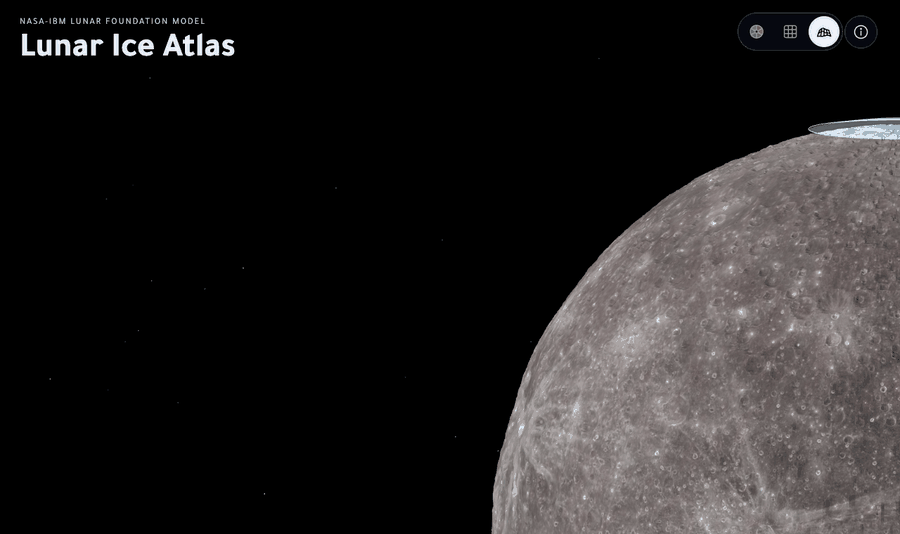
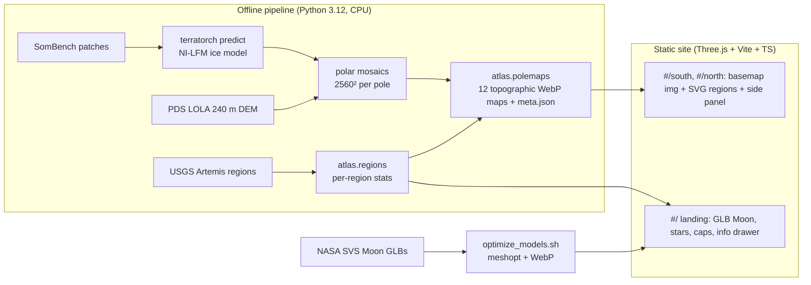

# Lunar Ice Atlas

**Live site:** https://caelwynder.github.io/lunar-ice-atlas/



I ran NASA and IBM's new **Lunar Foundation Model** (NI-LFM, released September 2026) on a laptop CPU, with no GPU, over every polar patch in the SomBench ice dataset. Then I built a site that shows what it predicts. You land on NASA's 3D Moon. Clicking either glowing pole opens a topographic map of the model's **ice prospectivity**, and at the South Pole the map is overlaid with the nine Artemis candidate landing regions.

## What I ran

| | |
|---|---|
| Model | NI-LFM fine-tuned **Ice-Prospectivity** (ViT-B backbone, TerraTorch) |
| Data | SomBench ice-prospectivity patches: 162 (81 per pole), 256×256 at 238.56 m/px |
| Hardware | Apple M1 Pro **CPU only**, 13.4 min for all 162 patches (≈4.9 s/patch, 5.1 GB peak) |
| Test RMSE / R² / MAE | **0.0277** / **0.990** / 0.0185 (model card: 0.0293 / 0.988 / 0.0197) |
| RMSE by pole | North 0.0298, South 0.0236 |

## What you can do on the site

- **Orbit NASA's Moon** in three renders: Colour, Grid and Topography (NASA SVS models).
- **Open the run log** (ⓘ): run statistics, accuracy by pole, and every Artemis region ranked by predicted prospectivity.
- **Click a polar cap** to open its map, drawn on LOLA topography (contours every 500 m), in three styles:
  - **Bands:** prospectivity classes 0.4–0.6 / 0.6–0.8 / 0.8–1
  - **Glow:** a smooth gradient
  - **Hotspots:** the top 15% only
- **Dark or moon-grey** map themes. The South Pole map shows the nine Artemis III candidate regions (the first crewed landing is now Artemis IV, early 2028), numbered and linked to a ranked table.

## Architecture



There's no backend and no API keys. All model inference happens offline, and the site only serves its outputs.

## Reproduce

```bash
conda create -n ni-lfm python=3.12 -y && conda activate ni-lfm
pip install -e vendor/ni-lfm && pip install pyproj shapely pyogrio pytest ruff mypy && pip install -e .
bash scripts/fetch_data.sh              # ~4.6 GB: model, backbone, SomBench, LOLA DEMs
bash scripts/predict_all.sh             # 162 patches on CPU, ~13 min
bash scripts/optimize_models.sh         # needs NASA SVS Moon GLBs in "Moon Renders/"
python -m atlas.build all               # regions.json + 12 pole basemaps
cd web && npm ci && npm run dev
```

Checks: `pytest -q && ruff check pipeline && mypy`, then in `web/`: `npm test && npm run typecheck && npm run lint && npm run e2e`.

## Performance

| | |
|---|---|
| Site size | 36 MB (models 27 MB, maps 8 MB, code 0.7 MB) |
| Lighthouse (desktop) | Performance 99, Accessibility 100 |
| Orbit | 120 fps (Topography) on an M1 Pro |

More detail is in [`docs/benchmarks.md`](docs/benchmarks.md).

## Read this before drawing conclusions

- The ice target is *"a knowledge-driven model, not measured ice."* (NASA-IBM Ice-Prospectivity model card)
- Outputs *"shouldn't substitute for instrumental measurements or operational decision-making regarding lunar landing sites."* (NI-LFM model card)
- "Flat" uses slope on a 240 m baseline, which is smoother than the terrain a lander actually sees. The maps smooth predictions to about 5 km.

## Credits

- **Models:** NASA & IBM, NI-LFM (Apache-2.0)
- **Data:** SomBench (CC-BY-4.0); NASA PDS LOLA
- **Moon renders:** NASA's Goddard Space Flight Center / NASA Scientific Visualization Studio
- **Artemis regions:** USGS, *Down Selected Artemis III Candidate Landing Site Navigational Grids*, DOI 10.5066/P1MEQ6UK (CC0)
