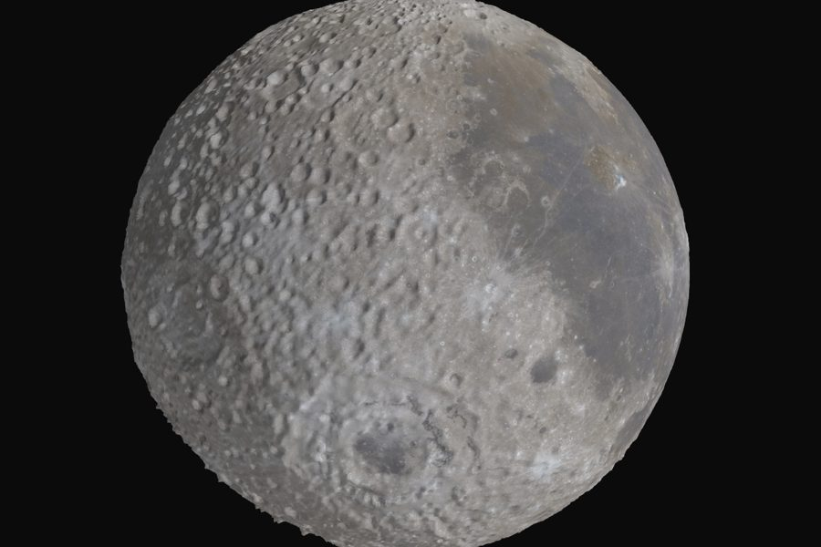
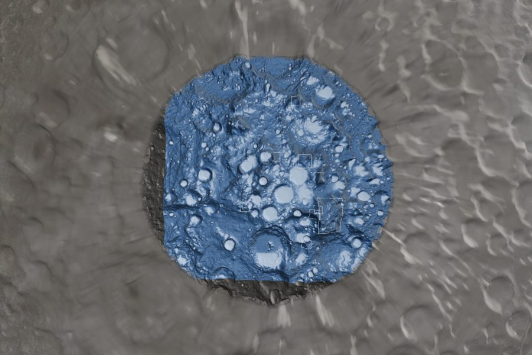
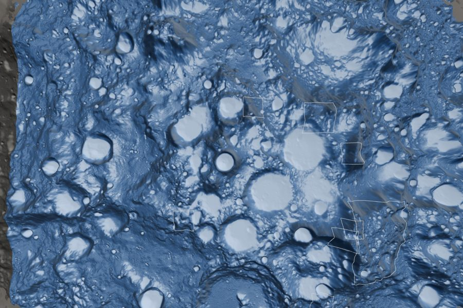
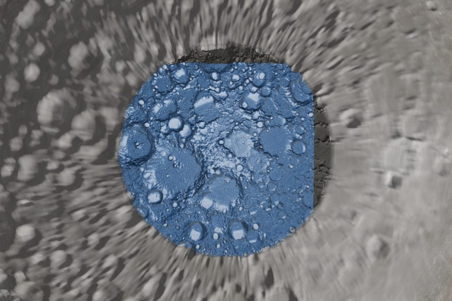

# Task 12 explained: the first visible Moon

## The one-sentence version

The website now **shows a real, interactive 3D Moon**: a textured globe with exaggerated relief, both polar caps draped with the NASA/IBM model's ice-prospectivity layer, the nine Artemis region outlines, and the plumbing for hover readouts and "fly to" camera moves.

---

## Why this step is needed

Tasks 9–11 built invisible parts: maths, data loading, and 3D shapes. This task puts them **on screen**. It adds everything a 3D scene needs:

- a **renderer** (draws to the page),
- a **camera** you can orbit and zoom with the mouse,
- **lights** so the relief casts shading,
- **materials** that paint the colour image, the terrain shading and the ice layers onto the shapes,
- **picking**, which answers "what's under the mouse?", for the readout coming in Task 13.

---

## Background you need

| Term | Plain meaning |
|---|---|
| **Renderer** | The Three.js part that turns the 3D scene into pixels on the page, about 60 times a second. |
| **Orbit controls** | Drag to rotate around the Moon, scroll to zoom. |
| **Material** | How a surface looks: which image is painted on it, and how it reacts to light. |
| **Overlay** | A semi-transparent layer (the ice map) drawn just on top of the terrain. |
| **Picking** | Working out which point on the Moon is under the mouse. |
| **Raycasting** | The usual way to pick: shoot an imaginary ray from the camera through the mouse and find the first triangle it hits. |
| **Antimeridian** | The 180° longitude line, where the globe's image and mesh "wrap around" and join up. |

---

## What Task 12 did, step by step

1. **Picking (`picking.ts`), written test-first.**
   - `lookupValues` turns a lat/lon near a pole into a position on that pole's map and reads the ice values and height there. The test checks the south pole lands in exactly the right grid cell.
   - **Changed from the plan, for speed:** the plan picked by raycasting against every triangle. I measured that on the real Moon: **19 ms per pick**, longer than a whole animation frame (16.7 ms), so hovering would have made the Moon stutter. Instead, `raySurface` does it with maths: hit a sphere, look up the terrain height there, hit a sphere raised to that height, and repeat a few times. That takes **microseconds**, lands on the same bumpy surface you see, and has its own tests.

2. **The scene (`scene.ts`).**
   - The renderer, the camera with orbit and zoom, and three lights (a "sun", a soft fill from below so the south pole isn't black, and ambient light).
   - The **globe**: the LROC colour image on the displaced globe from Task 11 (the 2k image on small screens, 4k otherwise).
   - Each **polar cap** has three layers sharing one shape:
     1. **base**: the terrain shading (hillshade) from Task 5,
     2. **overlay**: the selected ice layer (`pred`, `ref`, `err` or `psr`), 85% opaque,
     3. **outline**: white outlines of the held-out test patches, which can be switched on.
   - A small shader patch makes every cap layer **fade out at its edge**, using the edge-fade values from Task 11, so the caps blend into the globe.
   - **Fly-to** smoothly swings the camera to any lat/lon over 1.2 s. It jumps instantly for people who've turned on "reduce motion" in their system settings.

3. **Region outlines (`regionsLayer.ts`).** It draws the 9 Artemis footprints as lines hugging the terrain. The selected one turns amber (the only place amber is used).

4. **Start-up (`main.ts`, `index.html`, `styles.css`).** It loads the globe, both poles and the regions **in parallel**, shows "Loading lunar data…" meanwhile, and shows a clear message if anything fails. The page layout is ready for Task 13's control panel, readout and About box.

5. **Looked at it**, using an automated browser (Playwright + Chromium), and fixed two things the screenshots revealed:
   - **Broken region outlines.** They were lifted 150 m above the ground, but at 6× exaggeration the steep massifs poked through the lines between points. I raised them to 500 m, and all 9 now draw as complete shapes.
   - **A line at the 180° meridian.** The globe's first and last columns of points sit in the same place, but (a) they read heights from opposite edges of the height map, so they differed, and (b) each side calculated its lighting separately. Both are fixed: heights now wrap around, and the shared edge uses an averaged lighting direction. There are two new tests, and a pixel measurement confirms no remaining jump.

---

## What it accomplished

### The Moon, as it renders now

**The whole globe**, looking at 90°W. The bullseye at the bottom is **Mare Orientale** and the dark plains on the right are **Oceanus Procellarum**, exactly where they belong, which confirms the orientation work from Task 11:



**The south pole**, with the ice-prospectivity layer (paler = higher) draped over the terrain. The dark crescent at the left and bottom is the ~9% of the polar cap where the dataset has no model coverage. It's shown as plain terrain, deliberately not faked:



**Closer in**, with the Artemis region footprints drawn as white outlines on the terrain:



**The north pole:**



### Checks from the plan

| Check | Result |
|---|---|
| (a) Globe is textured with visible relief | ✅ Correct features in correct places |
| (b) Caps meet the globe with no crack or flicker | ✅ |
| (d) The ice layer shows, and the no-data crescent is empty | ✅ |
| (e) Region outlines sit on the south cap | ✅ After raising them to 500 m |

### Tests and build

- **41** website tests pass (6 new), and typecheck and lint are clean.
- `npm run build` works. The code bundle is **144 KB** compressed (mostly Three.js), so with the 36.7 MB of data the site stays inside its 40 MB budget.

---

## Known issue (cosmetic, not a bug)

Between about 60° and 80° latitude the globe looks **streaky, like motion blur pointing at the pole**. That comes from the source data, not our code. The whole-Moon images are longitude/latitude grids, and near the poles each pixel is squeezed to about 0.5 km wide but still 2.7 km tall, so features smear toward the pole. This is exactly why the project uses separate polar-map caps, but the caps only reach 80° because the ice data stops there. If it bothers you, a later task could soften it by reducing the relief exaggeration near the caps.

---

## What it did *not* do (yet)

- **No controls on screen yet.** The layer switcher, legend, hover readout and About box come in Task 13. For now the page always shows the `pred` layer.
- **No region panel.** Clicking a region, fly-to buttons and statistics bars come in Task 14.

---

## How to see it yourself

```bash
cd web
npm run dev        # then open http://localhost:5173
```

Drag to rotate, scroll to zoom. To re-run the checks:

```bash
npm test && npm run typecheck && npm run lint && npm run build
```

The task's checklist is in [`plan.md`](../plan.md), Task 12.
