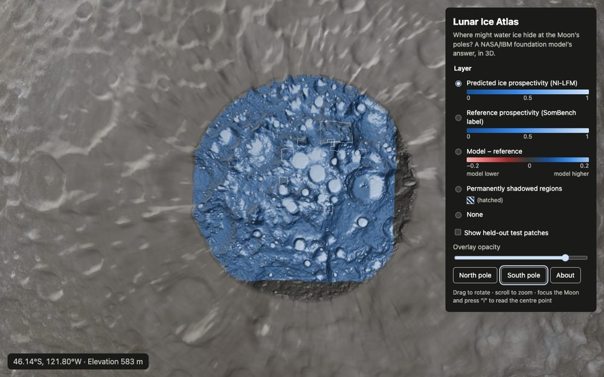
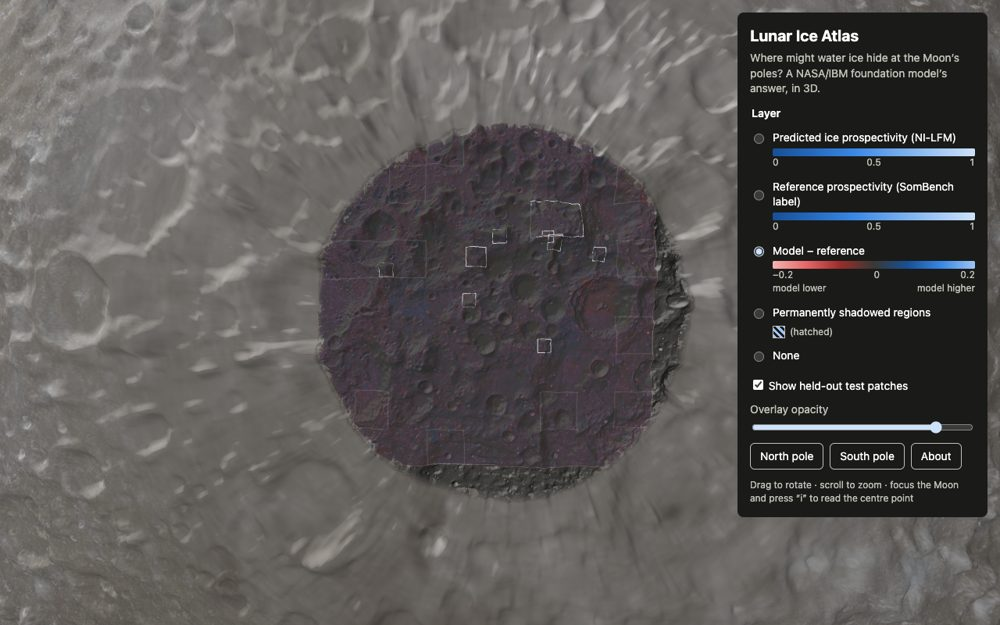
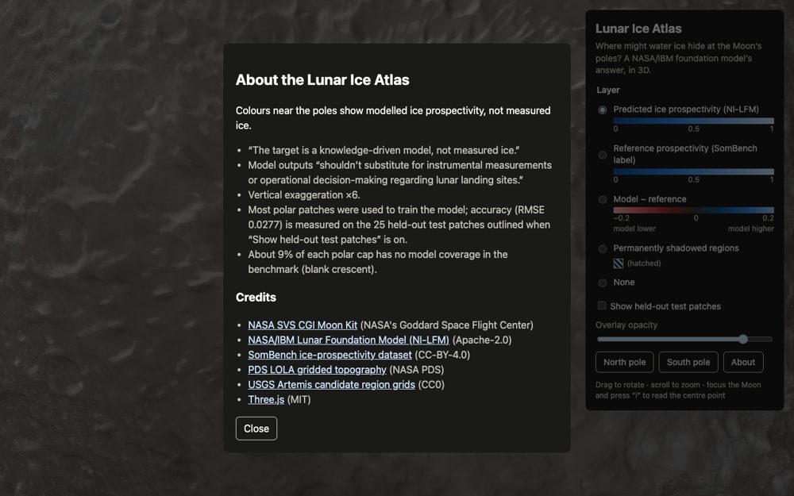

# Task 13 explained: the controls, legends, readout and About box (P1 complete)

## The one-sentence version

We added the **user interface**: a side panel to switch ice layers (each with its colour legend), an opacity slider, "fly to pole" buttons, a live **hover readout** of the numbers under the mouse, and an **About** box with the model's caveats and credits. With this, the **Lunar Ice Atlas (P1) is feature-complete**.

---

## Why this step is needed

After Task 12 the Moon was on screen, but a visitor couldn't *do* anything except rotate it, and couldn't tell what the colours meant. A data visualisation has to answer three questions:

1. **What am I looking at?** → a layer name and a legend with numbers
2. **What's the value right here?** → a readout under the mouse
3. **How far should I trust it?** → an About box with the honest caveats and the measured accuracy

---

## Background you need

| Term | Plain meaning |
|---|---|
| **Legend** | The key that says which colour means which value. |
| **Sequential vs diverging scale** | *Sequential* runs low → high (ice prospectivity 0 → 1). *Diverging* has a meaningful middle (model − reference: below zero = model lower, above zero = model higher). |
| **Readout** | A small text box showing the exact numbers under the mouse pointer. |
| **RMSE** | *Root mean square error*: the model's typical error. 0.0277 means predictions are typically about 0.03 away from the reference on a 0–1 scale. |
| **Held-out test patches** | The 25 patches the model **never saw during training**. Accuracy measured on them is the honest number. |
| **Focus ring** | The visible outline showing which control the keyboard is on, essential for people who don't use a mouse. |
| **Modal dialog** | A pop-up that keeps keyboard focus inside it until closed (Esc closes it). |

---

## What Task 13 did, step by step

All code is in `web/src/ui/`, with the tested parts written test-first.

1. **Legends (`legend.ts`).** Each layer's legend is built from the colour stops the pipeline wrote in Task 6, so the legend can never disagree with the map:
   - **Ice prospectivity (predicted and reference):** a smooth colour bar with ticks at 0, 0.5 and 1.
   - **Model − reference:** ticks at −0.2, 0 and 0.2 (with a proper minus sign), **plus the words "model lower" and "model higher"**, so the meaning doesn't depend on colour.
   - **Permanently shadowed regions:** a hatched swatch plus the word "(hatched)", so it isn't signalled by colour alone.

2. **Readout (`readout.ts`).** It turns what's under the mouse into plain text. For example, this real reading from the browser check is at the edge of the south cap, where the model has no data:
   `80.44°S, 74.17°E · Elevation −1,135 m · Predicted — · Reference — · Model − reference —`
   - Where the model has no data, the values show **"—"**, never a fake 0.
   - Off the polar caps, it shows just the coordinates and elevation.

3. **About box (`about.ts`).** It contains:
   - The two **model-card caveats, quoted word for word**: the target is "a knowledge-driven model, not measured ice", and the output "shouldn't substitute for … operational decision-making regarding lunar landing sites".
   - The **measured accuracy, RMSE 0.0277 on the 25 held-out test patches** (from Task 3), plus a note that most patches were used for training.
   - The vertical exaggeration (×6), and the ~9% of each cap with no coverage.
   - **Credits with links**: NASA SVS, NASA/IBM NI-LFM, SomBench, PDS LOLA, USGS Artemis grids and Three.js, with their licences.

4. **The panel (`layers.ts`).**
   - Layer choices: *Predicted*, *Reference*, *Model − reference*, *Permanently shadowed regions*, or *None*, each with its legend underneath.
   - "Show held-out test patches" draws the outlines of the 25 test patches.
   - An overlay opacity slider, so you can see the terrain under the colours.
   - "North pole" / "South pole" buttons that fly the camera there.
   - The hover readout updates **at most once per screen refresh**, so it stays smooth.
   - **Keyboard:** everything is reachable with Tab and shows a focus ring. With the Moon focused, pressing **i** reads the point at the centre of the screen.

5. **Checked it in a real browser** (automated Chromium) and fixed two small things it found:
   - **"−0.00" and "0.00°W".** A tiny negative number like −0.0016 was shown as "−0.00", and a longitude a hair below zero as "°W". Numbers are now rounded *before* choosing the sign, so they read "0.00" and "0.00°E". A new test covers all three cases.
   - **A repeated label.** The shadowed-regions option said "Permanently shadowed regions" twice. The legend line now just says "(hatched)".

---

## What it accomplished

### The atlas, with its controls



The **Model − reference** layer, with the held-out test patches switched on:



The **About** box:



### What the browser check confirmed

| Check (from the plan) | Result |
|---|---|
| Every layer switches, with the right legend | ✅ All 5 options |
| Hover values change over the cap and show "—" in the crescent | ✅ e.g. at 80.44°S, 74.17°E: "Predicted —" |
| About opens, and Esc closes it | ✅ 6 credit links |
| Tabbing shows a focus ring on every control | ✅ Including the Moon itself; "i" reads the centre point |

A sanity check on a surprising number: right next to the south pole (89.9°S, 0°E) the readout says **Predicted 0.00**. I checked the raw data file and it really is 0.004 there. That spot is on the sunlit ridge beside Shackleton crater, where ice is unlikely, so the readout is telling the truth.

### Tests

**47** website tests pass (6 new), typecheck and lint are clean, and the production build works.

| Test | What it proves |
|---|---|
| `renders a gradient with min/mid/max ticks …` | Ice legends show a colour bar with 0 / 0.5 / 1. |
| `labels diverging poles in words and uses a true minus sign` | The error legend says "model lower/higher" and uses "−". |
| `marks binary layers as hatched` | The shadow layer is marked by pattern and word, not colour alone. |
| `formats coordinates, elevation and layer values` | Readout text is formatted exactly, with "—" for no data. |
| `omits elevation when unknown` | No fake elevation when there isn't one. |
| `never shows a negative zero after rounding` | No "−0.00", "−0 m" or "0.00°W". |

---

## One thing to fix in Task 14

The **Artemis region outlines** and the **test-patch outlines** are both white squares, so they're easy to confuse. Task 14 (the region explorer) adds labels and selection for regions, which is the natural place to make them clearly different. This is noted in `plan.md`.

---

## What it did *not* do (yet)

- **No region explorer.** Clicking an Artemis region, its statistics and fly-to buttons come in Task 14 (P3).
- **No automated browser tests in the project yet.** Today's browser check was a one-off script. Task 15 adds permanent end-to-end tests, performance and accessibility checks, and deployment.

---

## How to try it

```bash
cd web
npm run dev        # open http://localhost:5173
```

Pick a layer, hover over a pole, press About. To re-run the checks:

```bash
npm test && npm run typecheck && npm run lint && npm run build
```

The task's checklist is in [`plan.md`](../plan.md), Task 13.
