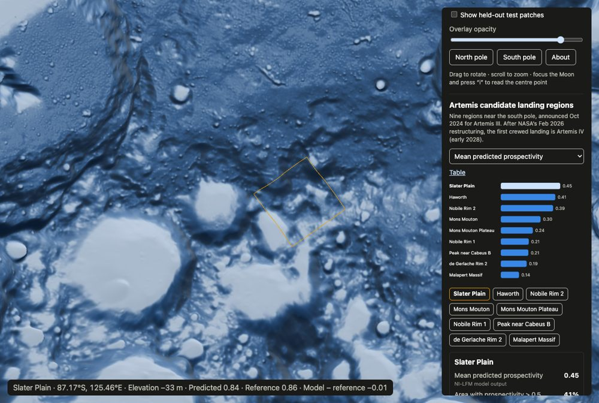
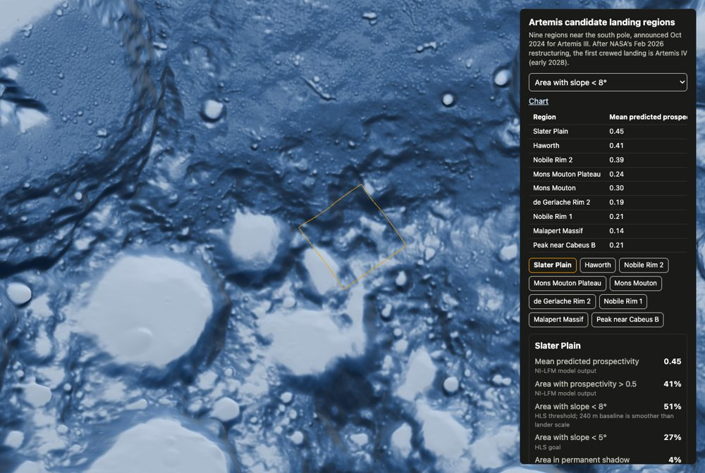

# Task 14 explained: the Artemis region explorer (P3 complete)

## The one-sentence version

We added a **"compare the landing regions" panel**: a bar chart ranking NASA's nine south-pole candidate regions by any of six measures (predicted ice, flat ground, shadow, temperature…), clickable region buttons that **fly the camera there and highlight the outline in amber**, a detail card of statistics, and a table view. With this, the **Artemis region explorer (P3) is feature-complete**.

---

## Why this step is needed

Task 7 measured each region (how much ice the model predicts, how flat, how shadowed, how cold), and Task 8 saved those numbers in `regions.json`. But nothing on the website showed them. This task turns them into something a visitor can explore:

- *"Which region does the model think is iciest?"* → sort the chart by predicted prospectivity
- *"Which has the most flat ground for a lander?"* → sort by "Area with slope < 8°"
- *"Show me Haworth."* → click it, and the camera flies there

---

## Background you need

| Term | Plain meaning |
|---|---|
| **Candidate landing region** | One of the nine areas near the south pole that NASA is considering for the first crewed landing (announced for Artemis III in 2024; the first landing is now Artemis IV, early 2028). |
| **Footprint** | The region's outline, from the USGS navigation-grid files (Task 7). |
| **HLS slope limits** | NASA's Human Landing System needs ground flatter than **8°**, ideally **5°**. |
| **Bar chart, one series** | One bar per region, all one colour, so there's no legend box; the title says what's measured. |
| **Point-in-polygon** | Deciding whether a point (e.g. under the mouse) is inside an outline. |

---

## What Task 14 did, step by step

Code is in `web/src/ui/`, with the logic written test-first.

1. **The six measures (`regionChart.ts`).** Each comes with a plain label, a unit and a short source note:

   | Measure | Shown as | Note shown to the visitor |
   |---|---|---|
   | Mean predicted prospectivity | 0.45 | NI-LFM model output |
   | Area with prospectivity > 0.5 | 41% | NI-LFM model output |
   | Area with slope < 8° | 51% | HLS threshold; 240 m baseline is smoother than lander scale |
   | Area with slope < 5° | 27% | HLS goal |
   | Area in permanent shadow | 4% | LOLA-derived PSR mask |
   | Mean max surface temperature | 220 K | Diviner |

2. **The bar chart.** Horizontal bars in one blue, sorted highest first. The **selected region gets two cues**, a lighter bar *and* a bold name, so it doesn't rely on colour alone. Each bar can be reached with the keyboard and announces its exact value to screen readers (e.g. "Slater Plain: 0.45"). A region with no value shows "no data" instead of a bar.

3. **Sorting (`sortRegions`).** Highest first, regions with no data last, and it **never modifies the original list** (tested).

4. **Region buttons and card (`regions.ts`).** Clicking a region:
   - **flies the camera** to its centre (about 200 km up),
   - **turns its outline amber** on the Moon (amber is used only for "selected"),
   - shows a **card with all six measures** and their notes.

5. **Table view.** A "Table" link swaps the chart for a table with all regions and all measures, for people who prefer exact numbers or use a screen reader.

6. **Hovering names the region (added beyond the plan).** In Task 13 I noted that the white region outlines were easy to confuse with the white test-patch outlines. Now, when the mouse is over a region, **the readout starts with its name**, e.g. `Slater Plain · 87.17°S, 125.46°E · …`. The check (`regionAt`) runs on the flat polar map, like the rest of the pipeline, and has its own test.

7. **Honest labelling.** The panel says the regions were announced for Artemis III and that the first crewed landing is now Artemis IV. It credits USGS with the DOI and download date, and says **"Statistics are illustrative and not for landing-site decisions."**

---

## What it accomplished

### Selecting a region

Clicking **Slater Plain**: the camera flies there, the outline turns amber, the bar and button are highlighted, the card shows its measures, and hovering names the region in the readout:



### The table view, sorted by flat ground



### What the browser check confirmed

| Check | Result |
|---|---|
| All 9 outlines show on the south cap | ✅ |
| Clicking a region flies there and turns it amber | ✅ The screen centre lands at **87.17°S, 125.46°E**, exactly Slater Plain's centre from Task 8 |
| The card shows the right numbers | ✅ 0.45 / 41% / 51% / 27% / 4% / 220 K, identical to Task 7's measurements |
| Changing the measure re-sorts the chart | ✅ For flat ground: Slater Plain 51% … Peak near Cabeus B 4% |
| The Table toggle works | ✅ 9 rows |
| Hovering a region names it | ✅ |

The fly-to landing exactly on the region's true centre is a nice end-to-end confirmation of the Task 8 fix: before it, centres computed in lon/lat were up to 1.4 km off.

### What the comparison shows

Ranked by predicted ice prospectivity: **Slater Plain (0.45)**, Haworth (0.41), Nobile Rim 2 (0.39), Mons Mouton (0.30), Mons Mouton Plateau (0.24), Nobile Rim 1 (0.21), Peak near Cabeus B (0.21), de Gerlache Rim 2 (0.19), Malapert Massif (0.14). Slater Plain also has the most flat ground (51% under 8°) and is the coldest (220 K).

### Tests

**51** website tests pass (4 new), typecheck and lint are clean, and the production build works.

| Test | What it proves |
|---|---|
| `sorts descending with nulls last and does not mutate input` | Ranking is correct, "no data" goes last, and the original list isn't changed. |
| `finds the region under a south-polar point …` | The hover check finds the right region, and nothing outside it or at the north pole. |
| `draws one bar per non-null region and marks the selection twice` | Missing data shows "no data"; selection = lighter bar **and** bold name; the exact value is readable by screen readers. |
| `table view carries the same values` | The table has the same numbers as the chart. |

---

## Important caveats (shown on the site)

- **Illustrative, not landing-site assessments.** The model card says outputs shouldn't be used for landing-site decisions.
- **Slopes are measured over 240 m pixels**, which is smoother than what matters to a real lander.
- **Region outlines are USGS grid footprints**, a bit larger than NASA's official ~15 × 15 km region descriptions.

---

## What it did *not* do (yet)

Task 15 is the last task: permanent automated browser tests, performance and accessibility checks, deployment to a public URL, and a README.

---

## How to try it

```bash
cd web
npm run dev        # open http://localhost:5173
```

Scroll the side panel to **Artemis candidate landing regions**, pick a measure, and click a region. To re-run the checks:

```bash
npm test && npm run typecheck && npm run lint && npm run build
```

The task's checklist is in [`plan.md`](../plan.md), Task 14.
