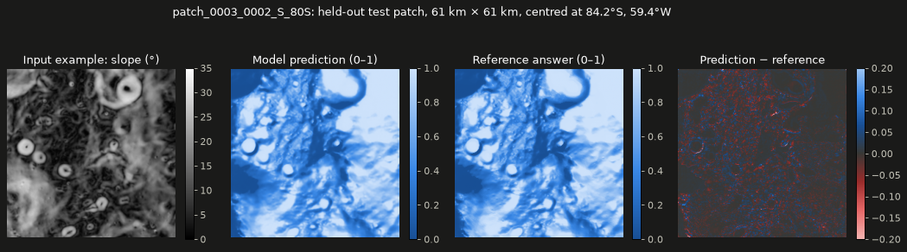

# Task 3 explained: running the ice model over both lunar poles

## The one-sentence version

We ran NASA and IBM's fine-tuned **ice-prospectivity model** on every map tile of the Moon's north and south polar regions, on a laptop CPU, and saved one prediction map per tile. Those maps are what the 3D Moon will eventually show.

---

## Background you need

| Term | Plain meaning |
|---|---|
| **Ice prospectivity** | A score from 0 to 1 for how likely water ice is in the top ~1 m of lunar soil. It's an *estimate*, not a measurement. |
| **Patch** (or tile) | A square piece of the polar map, 256 × 256 pixels. Each pixel is ~239 m, so one patch is about **61 km × 61 km**. |
| **The dataset** | SomBench *Ice-Prospectivity-Regression* from NASA/IBM: **162 patches**, 81 around each pole, arranged in a 9 × 9 grid covering about 91% of the area above 80° latitude (a ~55 km crescent on one side has no tiles). |
| **Inputs** | 8 map layers per patch that the model reads: slope, aspect (which way the ground faces), curvature, max surface temperature, ice-stability depth, permanent-shadow mask, shadow density, and distance to the nearest permanent shadow. |
| **Reference answer** | A prospectivity map (`PRO`) built by scientists with a knowledge-driven method. The model learned to reproduce it. |
| **Train / val / test** | The dataset's patches are split into 108 for training, 23 for tuning, and **25 held out for testing**. Only the test patches give an honest accuracy score, because the model never saw them. |

---

## What Task 3 did, step by step

1. **Added a filename helper** (`pipeline/atlas/tiles.py`).
   Patch files are named like `patch_0003_0002_S_80S_SLOPE.tif`. The helper pulls out the patch ID (`patch_0003_0002_S_80S`) and which pole it belongs to (`_S_80S` = south, `_80N` = north). It was written test-first, with 4 unit tests.

2. **Wrote a one-command prediction script** (`scripts/predict_all.sh`).
   It reuses the CPU setup from Task 1 (`scripts/cpu_config.sh`, which switches the model's config from GPU to CPU) and calls `terratorch predict` on all 162 patches.

3. **Ran it on the laptop CPU.**
   For each patch the model reads the 8 input layers and writes one prediction map. The result lands in `data/derived/pred_tiles/`, one file per patch, e.g. `patch_0003_0002_S_80S_ASP_SIN_COS_pred.tif`. (The odd `ASP_SIN_COS` part is just the name of the first input layer. TerraTorch borrows it for the output filename.)

4. **Checked the outputs automatically** with two new data tests in `pipeline/tests/test_tiles.py`:
   - All 162 files exist, are 32-bit floats, sit at **exactly the same map location** (projection and pixel grid) as their input patch, and hold values in the expected 0–1 range.
   - The error on the 25 held-out test patches matches the published model card.

---

## What it accomplished

### It worked, on a laptop, in about 13 minutes

| Measure | Result |
|---|---|
| Patches predicted | **162 / 162** (both poles) |
| Total time | **13.4 min** (≈ 4.9 s per patch) |
| Peak memory | 5.1 GB of 16 GB |
| GPU needed? | **No** |

### The predictions are accurate

RMSE is the typical size of the error on the 0–1 scale; lower is better.

| Patches | RMSE | What it tells us |
|---|---|---|
| **25 held-out test patches** | **0.0277** | The honest score. It beats the model card's 0.0293 slightly, and matches our Task 1 benchmark exactly, which confirms prediction and evaluation handle the data identically. |
| 108 training patches | 0.0264 | Only a little better than test, so the model isn't just memorising. |
| 23 validation patches | 0.0283 | In line with test. |
| All 81 north-pole patches | 0.0298 | |
| All 81 south-pole patches | 0.0236 | The south pole is predicted a bit more accurately. |

An error of ~0.03 on a 0–1 scale means the model's map is visually almost indistinguishable from the reference map.

### What it looks like

One **held-out test patch** (the model never trained on it), 84.2°S:



- **Left:** one of the 8 inputs (slope). Bright rings are crater walls.
- **Middle two:** the model's prediction and the reference answer. Pale blue = high ice prospectivity, dark blue = low. They look almost identical.
- **Right:** the difference. It's mostly neutral grey, with faint red (model lower) and blue (model higher) speckles along sharp crater edges. This patch's RMSE is 0.020.

---

## What it did *not* do (yet)

- **The 162 tiles are still separate squares.** Task 4 stitches each pole's 81 tiles into one seamless map.
- **Predictions outside the 80° circle are meaningless.** The corner tiles stick out past 80° latitude. Several input layers (such as temperature and ice-stability depth) are blank there, and the model's setup fills blanks with zeros, so those predictions aren't trustworthy. Task 8 hides those areas using the reference map's outline.
- **Nothing is on the 3D Moon yet.** That starts in Task 9.

## Caveat to remember

The model reproduces a *knowledge-driven prospectivity map*, not measured ice. Its model card says outputs shouldn't be used for real landing decisions. The website will say this clearly.

---

## How to re-run it

```bash
conda activate ni-lfm
bash scripts/predict_all.sh                  # ~13 min on an M1 Pro CPU
pytest -m data pipeline/tests/test_tiles.py  # verifies the 162 outputs
```

Full numbers are in [`docs/benchmarks.md`](benchmarks.md). The task's checklist is in [`plan.md`](../plan.md), Task 3.
