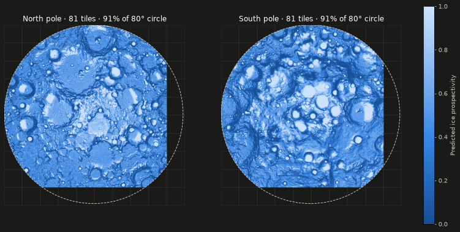

# Task 4 explained: stitching the tiles into one map per pole

## The one-sentence version

We took the 81 separate tiles around each pole, from both the model's predictions and the dataset's reference answers, and placed them into **one seamless 2,560 × 2,560 pixel map per pole**. That map is sized to cover the whole polar cap, so the 3D Moon can later draw each pole as a single piece.

---

## Why this step is needed

After Task 3 we had 162 little squares, each its own file. A 3D globe can't sensibly load 162 separate textures, and the website needs to answer questions like "what's the value at this latitude/longitude?". Both are much easier with **one big map per pole**.

The catch: to stitch tiles, you must know *exactly* where each one sits. If a tile is off by even a fraction of a pixel, you get visible cracks or doubled features.

---

## Background you need

| Term | Plain meaning |
|---|---|
| **Polar stereographic map** | A flat map of a polar region, as if you were looking straight down on the pole. The pole is the centre, and latitude circles become circles. |
| **Map coordinates (metres)** | Every pixel has an x/y position in metres on that flat map. Here the pole sits at x = 500,000 m, y = 500,000 m. |
| **Geotransform** | Six numbers stored inside each GeoTIFF that say where its top-left corner is (in metres) and how big each pixel is (238.56 m). This is how we know where a tile belongs. |
| **Cap grid** | Our target canvas: a **10 × 10 tile** square (2,560 px, ≈ 611 km across) around each pole, big enough to hold the entire region above 80° latitude. |
| **NaN** | "Not a number", used to mean "no data here". |

---

## What Task 4 did, step by step

All the code is in `pipeline/atlas/tiles.py` and was written test-first (7 new tests in `pipeline/tests/test_tiles.py`).

1. **Defined the canvas (`cap_grid`).**
   It builds the 10 × 10-tile grid for a pole: its map projection, pixel size and top-left corner, which starts where the dataset's tiles start. We chose 10 × 10, not the dataset's 9 × 9, because the 9 × 9 grid is off-centre and doesn't reach the far edge of the 80° circle. The extra row and column give the elevation data (Task 5) room to fill the entire cap.

2. **Worked out where each tile goes (`patch_offset`).**
   It reads a tile's geotransform and converts its corner position into a row and column on the canvas. It **refuses to guess**: if a tile is off-grid by more than 1% of a pixel, or has a different pixel size, it raises an error instead of silently smearing the data.

3. **Stitched the tiles (`mosaic`).**
   It starts with a canvas full of NaN ("no data") and copies each tile into its slot. It also converts each file's own "no data" marker to NaN, and errors if a tile would fall off the edge of the canvas.

4. **Made a "which area do these tiles cover?" mask (`footprint`).**
   It marks the area covered by a set of tiles, even where the tiles contain no data. Task 8 uses this to outline the 25 **held-out test tiles** on the website.

5. **Added a file finder (`patch_files`).**
   "Give me all the `_PRO.tif` files for the south pole", in a stable order, with an error if none are found.

---

## What it accomplished

### Both poles stitch perfectly into place

Each stitched map is 2,560 × 2,560 pixels with 4,587,767 pixels of real data, and every tile landed exactly on the grid (the alignment check never fired).



- **Pale blue** = high predicted ice prospectivity (often inside craters that never see sunlight). **Dark blue** = low.
- The **dashed circle** is 80° latitude, the edge of the polar cap.
- The **black strip** on the right and bottom of each circle is the part of the cap the dataset doesn't cover.

### The numbers

| Check | North | South | What it means |
|---|---|---|---|
| Share of the 80° cap with data | **91.0%** | **91.0%** | The dataset leaves a ~55 km crescent uncovered. The website will show it as "no model data" rather than hiding it. |
| Seam strength in the **reference** map | 0.99 | 1.01 | 1.0 means no seams, so the stitching itself adds no cracks. |
| Seam strength in the **predictions** | 1.37 | 1.41 | Pixel-to-pixel jumps are ~1.4× larger across tile borders, because the model predicts each tile without seeing its neighbours. It's too small to see at whole-pole scale (see the picture). |
| Predictions slightly outside 0–1 | 1.6% | 2.4% | The model can overshoot a little (−0.14 to 1.12). The website's colour scale will clamp these to 0 and 1. |

**How we checked the seams:** we compared how much neighbouring pixels differ *across* a tile border with how much they differ *inside* a tile. We also zoomed into one suspicious-looking straight edge on the south map. It appears in the reference map too, so it's a real feature of the data rather than a stitching error.

### Tests

| Test | What it proves |
|---|---|
| `test_cap_grid_covers_full_80deg_disk` | The canvas really reaches past the 80° circle on every side. |
| `test_patch_offset_exact_and_rejects_misaligned` | Tiles land on the exact row/column, and a tile shifted by 0.3 px is rejected. |
| `test_mosaic_places_tiles_and_leaves_nan` | Tiles go in the right spots, and gaps stay "no data". |
| `test_mosaic_rejects_tile_outside_grid` | A tile hanging off the edge causes an error, not a silent crop. |
| `test_footprint_marks_tile_extent_even_where_values_are_nan` | The coverage mask covers the whole tile even if its values are blank. |
| `test_real_label_mosaic_is_disk_with_crescent_gap` (north + south) | On the real data, the 10th column is empty and the data forms a disk with the expected crescent gap. |

All **20** pipeline tests pass, and ruff and mypy report no issues.

---

## What it did *not* do (yet)

- **No elevation yet.** Task 5 reprojects the LOLA elevation map onto this same canvas, so relief and predictions line up pixel for pixel.
- **The corner predictions aren't hidden yet.** The stitched *prediction* map still has values outside the 80° circle, which the picture hides using the reference map's outline. Task 8 does this permanently when it builds the website files.
- **No website files yet.** The colours, PNGs and value grids for the browser come in Task 6.
- **The mild seams aren't fixed.** Removing them would mean re-running the model on overlapping tiles and blending the overlaps. That's possible later, but not in the current plan, since they're invisible at the scale the site shows.

---

## How to re-run it

The stitching runs in memory whenever it's needed; there's no separate command. To re-check it:

```bash
conda activate ni-lfm
pytest pipeline/tests/test_tiles.py -v   # 13 tests, including both real poles
```

Full numbers are in [`docs/benchmarks.md`](benchmarks.md). The task's checklist is in [`plan.md`](../plan.md), Task 4.
