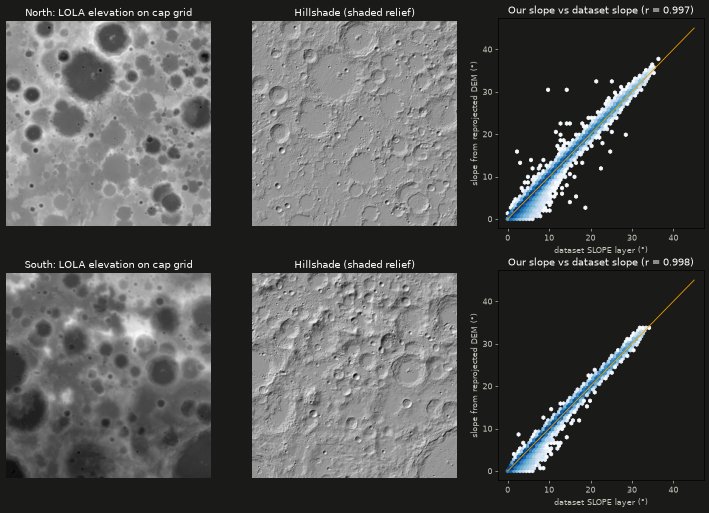

# Task 5 explained: putting real lunar elevation under the ice map

## The one-sentence version

We took NASA's laser-altimeter elevation maps of both lunar poles and redrew them onto **exactly the same pixel grid** as the stitched ice maps from Task 4. Then we **proved** they line up, by comparing the slopes we compute from them with the slope layer in NASA/IBM's own dataset.

---

## Why this step is needed

The 3D Moon needs two things at each pole:

1. **Shape**: how high or low every point is, so craters and mountains stick out in 3D.
2. **Colour**: the ice-prospectivity values drawn on top (Tasks 3–4).

These come from **different sources with different map grids**. If they're even slightly misaligned, a bright "icy" crater floor would be painted halfway up a crater wall. So we had to resample the elevation onto the ice grid, and then check the result rather than trust it.

---

## Background you need

| Term | Plain meaning |
|---|---|
| **LOLA** | The *Lunar Orbiter Laser Altimeter* on NASA's Lunar Reconnaissance Orbiter. It fires laser pulses at the Moon and times the echo to measure height. |
| **DEM** | *Digital Elevation Model*: a grid where each pixel stores a height. We use the PDS polar DEMs `ldem_75n_240m` / `ldem_75s_240m` (north/south, 240 m pixels, 29 MB each). |
| **Height reference** | Heights are metres above (or below) a perfect sphere of radius **1,737.4 km**. The file stores whole numbers that must be multiplied by 0.5 to get metres. |
| **Reprojecting** | Redrawing a map from one grid onto another. Our two grids use the same kind of polar map but differ slightly: the DEM has 240 m pixels and scale factor 1.000, while the ice grid has 238.56 m pixels and scale factor 0.994. So they can't just be overlaid; every pixel has to be recomputed. |
| **Bilinear resampling** | Each new pixel's height is a weighted average of the 4 nearest source pixels. It's smooth and standard for elevation. |
| **Slope** | How steep the ground is, in degrees (0° = flat). |
| **Hillshade** | A grey "shaded relief" picture that makes a DEM look lit by a low sun, so terrain is easy to read. The website uses it as the base layer under the ice colours. |
| **Correlation (r)** | How closely two sets of numbers move together: 1.0 is a perfect match, 0 is no relationship. |

---

## What Task 5 did, step by step

All code is in `pipeline/atlas/dem.py`, written test-first with 8 tests in `pipeline/tests/test_dem.py`.

1. **Read the NASA elevation files (`read_pds_dem`).**
   It opens the PDS label/image pair, converts the stored whole numbers to metres (× 0.5), and turns the file's "no data" marker into NaN. One subtlety: the file also advertises an "offset" of 1,737,400, which is the Moon's radius. We deliberately **don't** add it, so heights stay small numbers like −2,000 m rather than 1,735,400 m. A test guards this.

2. **Redraw the elevation onto the ice grid (`to_grid`).**
   It uses `rasterio`'s reprojection with bilinear resampling, onto the same 2,560 × 2,560 cap grid as Task 4. The function returns a new array and never changes its input (also tested).

3. **Compute slope (`slope_deg`).**
   It measures how fast height changes left/right and up/down across 238.56 m pixels and turns that into an angle. It's tested on a perfect 10° ramp, which must come out as exactly 10°.

4. **Make shaded relief (`hillshade`).**
   It shades the terrain as if lit from the north-west, 30° above the horizon, and returns a 0–255 greyscale image. It copes with missing pixels by filling them with the average height before shading.

5. **Proved the alignment (the key test).**
   NASA/IBM's ice dataset already contains a **slope layer**, made from LOLA data on the ice grid. If our reprojected elevation sits in exactly the right place, *our* slope must match *their* slope pixel for pixel. If it were shifted, flipped or rotated, the match would collapse. During research a deliberately flipped version scored r ≈ 0.

---

## What it accomplished

### The elevation lines up almost perfectly at both poles

| | North pole | South pole |
|---|---|---|
| Cap grid filled with elevation | **100%** | **100%** |
| Height range | −5.0 km … +2.4 km | −7.3 km … +7.0 km |
| Match between our slope and the dataset's slope | **r = 0.9965** | **r = 0.9981** |
| Typical slope difference | 0.24° | 0.18° |
| Pixels compared | 5.3 million | 5.3 million |

The test requires r ≥ 0.99, and both poles clear it easily. This was also the **first time the north pole was checked**: the research phase only spot-checked three south-pole tiles.

Unlike the ice data, the elevation fills **the whole polar cap**, including the ~55 km crescent the ice dataset doesn't cover. So the 3D terrain will be complete, and only the ice colours will be missing in that strip.

### What it looks like



- **Left:** elevation (dark = low, light = high). The dark circles are deep craters.
- **Middle:** the hillshade, which the website will show under the ice colours.
- **Right:** every point compares one pixel's slope, ours (up) against the dataset's (across). They pile up along the orange diagonal, which means "same value". The north pole has a few scattered outliers, mostly on steep crater walls, but they're a tiny fraction of 5.3 million pixels.

### Tests

| Test | What it proves |
|---|---|
| `test_slope_of_known_plane` | A perfect 10° ramp measures as 10°. |
| `test_hillshade_flat_is_uniform_uint8` | Flat ground shades to a single grey. |
| `test_hillshade_tolerates_nan` | Missing pixels don't break the shading. |
| `test_to_grid_identity_when_grids_match` | Reprojecting onto an identical grid changes nothing. |
| `test_to_grid_does_not_mutate_input` | The original data is never modified. |
| `test_read_pds_dem_applies_scale_not_radius_offset` | Heights come out in sensible metres, and the file says the Moon is a 1,737.4 km sphere. |
| `test_pds_dem_aligns_with_dataset_slope` (north + south) | **The alignment proof: r ≥ 0.99 at both poles.** |

All **28** pipeline tests pass, and ruff and mypy report no issues. (One test used a lossy way of reading the map projection, which triggered a warning; it now reads the Moon's radius directly.)

---

## What it did *not* do (yet)

- **Nothing is saved to disk yet.** The elevation and hillshade are computed in memory. Task 6 turns them into small website files (a height grid for the 3D mesh and a hillshade JPEG), and Task 8 runs everything end to end.
- **The slope here is on a 240 m baseline.** That's smoother than what matters to a lander, which cares about metre-scale rocks and tilts. The Artemis region explorer (Task 14) will say so next to every slope number.

---

## How to re-run the checks

```bash
conda activate ni-lfm
pytest pipeline/tests/test_dem.py -v   # 8 tests, including the alignment proof for both poles
```

Full numbers are in [`docs/benchmarks.md`](benchmarks.md). The task's checklist is in [`plan.md`](../plan.md), Task 5.
