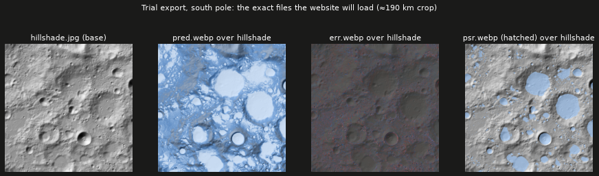

# Task 6 explained: turning the maps into website-ready files

## The one-sentence version

We wrote the code that converts each pole's science maps (elevation, predictions, reference answers, errors, shadowed craters) into a **small set of image and data files a web browser can load quickly**, using colour scales that were checked for colour-blind readability.

---

## Why this step is needed

After Tasks 4–5, each pole exists as big grids of decimal numbers in Python's memory. A browser can't use those directly. It needs:

- **pictures** it can paint onto the 3D Moon (with see-through areas where there's no data),
- a **small height grid** to build the 3D surface,
- **compact number grids**, so hovering the mouse can show the real value under the cursor,
- a **description file** that tells the website what each file is, where it sits on the Moon, and how to draw its legend.

And it all has to be small enough to download reasonably fast.

---

## Background you need

| Term | Plain meaning |
|---|---|
| **Colour ramp** | A rule that turns a number into a colour, e.g. 0 → dark blue, 1 → pale icy blue. |
| **Sequential ramp** | One hue from dark to light, for "more or less of something" (ice prospectivity). |
| **Diverging ramp** | Two hues meeting at a neutral grey, for "above or below zero" (model minus reference): red = model too low, blue = model too high, grey = spot on. |
| **Alpha (transparency)** | How see-through a pixel is. "No data" pixels are fully transparent so the terrain shows through. |
| **RGBA image** | An image with red, green, blue and alpha channels. |
| **Quantising** | Squeezing a decimal like 0.8123 into one byte (0–254), with 255 reserved to mean "no data". It takes a quarter of the space, and precision is still about 0.004. |
| **Mesh resolution** | The 3D surface uses every 4th pixel (640 × 640 points, ~950 m apart). The *pictures* stay full detail (2,560 × 2,560, ~239 m). |
| **Lossless WebP** | A modern image format that's smaller than PNG while keeping every pixel exactly the same. |

---

## What Task 6 did, step by step

Code lives in two new files, written test-first with **14 new tests**.

### 1. Colour and number tools: `pipeline/atlas/colorize.py`

| Function | What it does |
|---|---|
| `ramp_rgba` | Colours a map with a ramp, clamps out-of-range values (the model's rare −0.14 or 1.12 become 0 and 1), and makes "no data" transparent. |
| `stripe_rgba` | Draws **diagonal hatching**. Permanently shadowed regions are hatched *and* coloured, so they're recognisable without relying on colour alone. |
| `quantize_u8` | Packs values into bytes (0–254), with 255 meaning "no data". |
| `block_nanmean` | Averages 4 × 4 pixel blocks, ignoring blanks. This makes the smaller mesh-resolution grids. |

The colours themselves were chosen and **validated during planning** with the dataviz skill's palette checker (colour-blind separation, contrast against the dark background, even lightness steps):

- **Ice prospectivity:** dark blue `#184f95` → pale ice `#cde2fb` (6 steps)
- **Model − reference:** pink/red ← dark grey `#383835` → blue (7 steps)
- **Permanent shadow:** `#9ec5f4`, hatched

### 2. The exporter: `pipeline/atlas/export_web.py`

`export_pole(pole, layers, out_dir, …)` writes one folder per pole:

| File | What it is | Used for |
|---|---|---|
| `height.i16.bin` | 640 × 640 heights in whole metres | Building the 3D polar-cap surface |
| `hillshade.jpg` | Grey shaded relief, 2,560 × 2,560 | The terrain "base coat" |
| `pred.webp` | Model prediction, coloured | Main layer |
| `ref.webp` | Reference answer, coloured | Comparison layer |
| `err.webp` | Prediction − reference, red/grey/blue | "Where is the model wrong?" layer |
| `psr.webp` | Permanently shadowed regions, hatched | Context layer |
| `test.webp` | White outlines of the 25 held-out test tiles | Honesty layer: shows where accuracy was measured |
| `pred/ref/err.u8.bin` | Byte-packed values, 640 × 640 | Mouse-hover readout |
| `meta.json` | Map position, grid size, file names, legend colours | Tells the website how to use everything above |

`meta.json` is a **contract**: the website code (Task 10) checks it field by field, so if either side changes, a test fails instead of the site silently breaking.

---

## What it accomplished

### A trial run on the real south pole

The final export into the website folder happens in Task 8, but to check real sizes and looks we ran a **trial export** into a scratch folder. It took **11 seconds**.



- **Left:** the shaded-relief base.
- **Second:** predictions. Pale = high ice prospectivity, mostly inside shadowed crater floors.
- **Third:** errors. It's almost entirely dark grey, meaning the model is very close to the reference nearly everywhere.
- **Right:** permanently shadowed regions, hatched so they read without colour.

### A size problem found and mostly fixed

| | Per pole | Both poles + globe |
|---|---|---|
| First version (PNG images) | 31.7 MB | ≈ 68 MB |
| Lossless WebP | 21.3 MB | ≈ 47 MB |
| **Now (option B: pred/ref near-lossless)** | **15.4 MB** | **≈ 36 MB** |
| Plan's budget | | 40 MB |

The coloured overlays were the problem: 9–10 MB each as PNG. Switching to **lossless WebP** (the plan's own fallback) cut a third of the size with **pixel-identical** results, and a test proves no colour changed. That still left the site about 7 MB over budget, so you chose option B (see the end), which brings it to ≈ 36 MB.

### Tests

| Test | What it proves |
|---|---|
| `test_ramp_endpoints_and_nan_transparent` | 0 and 1 get the exact end colours; "no data" is invisible. |
| `test_ramp_clamps_out_of_range` | The model's rare overshoots don't produce odd colours. |
| `test_ramp_does_not_mutate_input` | The science data is never altered. |
| `test_quantize_reserves_255_for_nodata` | Byte packing is exact at 0, 0.5 and 1, and blanks become 255. |
| `test_block_nanmean_*` (3 tests) | Averaging ignores blanks, stays quiet on fully blank blocks, and rejects bad sizes. |
| `test_stripes_are_secondary_encoding` | Hatching really has two alternating strengths. |
| `test_export_pole_writes_contract` | `meta.json` has the agreed structure, layer order and file names. |
| `test_export_pole_file_contents` | Heights, byte grids and images contain the right values and transparency. |
| `test_export_pole_error_overlay_is_lossless` | The error layer is pixel-identical to the colours computed. |
| `test_export_pole_prediction_overlay_is_near_lossless` | Prediction colours stay within 3/255 on average, with transparency exact. |
| `test_export_pole_encodes_pred_ref_lossy_and_others_lossless` | Each file uses the intended WebP encoding. |
| `test_export_pole_does_not_mutate_layers` | Exporting never changes the input maps. |

All **42** pipeline tests pass, and ruff and mypy report no issues.

---

## What it did *not* do (yet)

- **It didn't write into the website folder.** Task 8 runs the real export for both poles plus the globe.
- **The test outlines aren't used yet.** The `test.webp` outline layer is empty until Task 8 feeds in the real test tiles (the trial did include them).
- **No region statistics yet.** The Artemis region stats come in Task 7.

---

## Decision: the ~7 MB overshoot (resolved: option B)

| Option | Site size | Trade-off |
|---|---|---|
| **A. Raise the budget to 50 MB** | ≈ 47 MB | Every pixel exact. Slower first load on mobile. |
| **B. Near-lossless for prediction and reference only** | ≈ 36 MB | Colour differences average 2/255, invisible to the eye. The hover values stay exact (they come from the `.u8.bin` files). The error layer stays lossless, because lossy compression visibly damaged it. |

**You chose B.** `pred.webp` and `ref.webp` are now saved near-lossless (WebP quality 95, transparency exact), and `err`, `psr` and `test` stay lossless. Re-measured on the real south pole: **15.4 MB per pole**, so the whole site is projected at **≈ 36 MB**, under the 40 MB budget. Two new tests lock this in: the prediction layer's colours stay within 3/255 on average, and each file uses the intended encoding (lossy `VP8` vs lossless `VP8L`).

---

## How to re-run the checks

```bash
conda activate ni-lfm
pytest pipeline/tests/test_colorize.py pipeline/tests/test_export_web.py -v
```

Full numbers are in [`docs/benchmarks.md`](benchmarks.md). The task's checklist is in [`plan.md`](../plan.md), Task 6.
