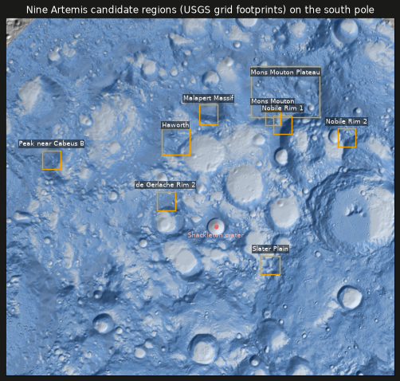

# Task 7 explained: measuring the Artemis landing regions

## The one-sentence version

We loaded NASA's **nine candidate landing regions** near the lunar south pole (from official USGS files) and, for each one, measured how much ice the model predicts, how steep and how shadowed the ground is, and how cold it gets. These numbers power the website's "compare the landing regions" panel.

---

## Why this step is needed

This is the second half of the project (P3: the Artemis region explorer). A visitor should be able to click a region like *Haworth* or *Slater Plain* and see, in plain numbers:

- **Is there likely ice nearby?** (from the NASA/IBM model)
- **Is the ground flat enough to land?** (from LOLA elevation)
- **How much of it is in permanent shadow, and how cold is it?** (from the dataset's thermal and shadow layers)

To compute those, we need each region's **exact outline** on our map, and a function that summarises every map layer inside that outline.

### A quick note on "Artemis III" vs "Artemis IV"

NASA picked these nine regions in October 2024 for **Artemis III**. In February 2026 NASA changed Artemis III into a test flight in Earth orbit, so the first crewed landing is now **Artemis IV (early 2028)**, and NASA's Artemis IV page still lists nine candidate regions near the south pole. The website will explain this in one line.

---

## Background you need

| Term | Plain meaning |
|---|---|
| **Candidate landing region** | An area NASA is considering for a crewed landing. Each contains several possible landing spots. |
| **USGS navigation grid** | A grid of 1 km squares (plus finer 100 m and 10 m versions) that USGS drew over each region so astronauts can give positions like map coordinates. We used the 1 km grids. |
| **Grid footprint** | The outer edge of a region's 1 km grid. **We use it as the region's area.** It's a little larger than NASA's stated ~15 × 15 km regions (most footprints are 21 × 21 km), so it probably includes a margin. The website will call it a *footprint*, not an official boundary. |
| **Mask** | A yes/no map marking which pixels fall inside a region. |
| **PSR** | *Permanently shadowed region*: ground that never sees direct sunlight. It's the coldest place on the Moon and the best spot for ice to survive. |
| **HLS slope limits** | NASA's Human Landing System needs ground flatter than **8°** (the limit), ideally **5°** (the goal). |

---

## What Task 7 did, step by step

Code is in `pipeline/atlas/regions.py`, written test-first with **10 tests** in `pipeline/tests/test_regions.py`.

1. **You downloaded the USGS files** (DOI 10.5066/P1MEQ6UK, public domain) into `data/artemis/`. The site blocks automated downloads, which is why this needed a person.

2. **The files turned out different from the plan's guess, so I adapted.**
   The plan expected one file with nine outlines and a name column. The real download has **one folder per region**, each holding grids of 1 km squares. The loader (`load_regions`) now:
   - finds each region's folder and matches it to NASA's official spelling (`Peak_Near_Cabeus_B` → "Peak near Cabeus B"),
   - merges its 1 km squares into **one outline** (the footprint),
   - tidies the outline, dropping the hundreds of redundant corner points along straight edges,
   - **refuses to continue if any of the nine regions is missing**, instead of silently showing eight.

   Handy discovery: the USGS files use **exactly the same map projection** as the ice data, so no conversion errors could creep in.

3. **Turned outlines into masks (`region_mask`).**
   Each outline is burned onto the 2,560 × 2,560 south-pole grid from Task 4, so it lines up pixel for pixel with the predictions, elevation and shadow layers.

4. **Summarised each region (`region_stats`).** For the pixels inside each mask:

   | Statistic | Meaning |
   |---|---|
   | `coverage` | Share of the region where the model has data |
   | `predMean`, `predP90`, `fracPredGt05` | Average predicted ice prospectivity, its 90th percentile, and the share of area above 0.5 |
   | `refMean` | Average of the reference answer, for comparison |
   | `slopeMeanDeg`, `fracSlopeLt8`, `fracSlopeLt5` | Average slope, and the share of area under the 8° limit and the 5° goal |
   | `fracPsr`, `psrDistMean` | Share in permanent shadow, and average distance to the nearest shadow |
   | `tmaxMeanK` | Average *maximum* surface temperature, in kelvin |

   If a region has no data, the numbers come out as "none" rather than a misleading 0.

5. **Confirmed the units of the "distance to shadow" layer.**
   The dataset doesn't say whether it's in metres, kilometres or pixels. I computed my own distance-to-nearest-shadow in metres and compared: the ratio is **1.006**, and the value is 0 inside shadows. So it's **metres**.

---

## What it accomplished

### All nine regions load, in the right places



How we know the positions are right:

- The layout matches **NASA's own region map** (LPSC 2026 abstract #1901): Mons Mouton Plateau at the top, Peak near Cabeus B far left, Slater Plain bottom centre, Nobile Rim 2 on the right.
- Each region's area on our grid matches the USGS square count **within 2%**. This is tested.
- **Shackleton crater**, which sits almost exactly on the south pole, lands 9.9 km from the centre of our grid, as it should.
- **All nine regions are 100% covered** by the model. None falls in the ~55 km strip the dataset leaves out.

### What the numbers say

| Region | Predicted ice (avg) | Area with ice > 0.5 | Area flatter than 8° | In permanent shadow | Max temp |
|---|---|---|---|---|---|
| **Slater Plain** | **0.45** | **41%** | **51%** | 4% | **220 K** |
| Haworth | 0.41 | 34% | 38% | 1% | 230 K |
| Nobile Rim 2 | 0.39 | 33% | 38% | **9%** | 231 K |
| Mons Mouton | 0.30 | 19% | 33% | 3% | 240 K |
| Mons Mouton Plateau | 0.24 | 16% | 37% | 2% | 254 K |
| Nobile Rim 1 | 0.21 | 14% | 17% | 2% | 258 K |
| Peak near Cabeus B | 0.21 | 19% | 4% | 0% | 264 K |
| de Gerlache Rim 2 | 0.19 | 9% | 25% | 2% | 251 K |
| Malapert Massif | 0.14 | 8% | 12% | 1% | 266 K |

**Reading it:**
- **Slater Plain** stands out: the highest predicted ice, the most flat ground, and the coldest.
- **Peak near Cabeus B** and **Malapert Massif** are mostly steep, which makes sense because they're mountains and high rims chosen for sunlight and Earth visibility, not for ice.
- In every region the model's average matches the reference answer to within 0.01, consistent with its accuracy.

Full numbers for all 11 statistics are in [`docs/benchmarks.md`](benchmarks.md).

### Tests

| Test | What it proves |
|---|---|
| `test_expected_regions_are_the_nine_nasa_names` | The list of regions is NASA's nine. |
| `test_slugify_makes_stable_ids` | Names turn into stable web IDs (e.g. `de-gerlache-rim-2`). |
| `test_region_mask_covers_expected_pixels` | A 10 km square covers exactly 100 one-km pixels. |
| `test_region_stats_values_and_coverage` | Averages, shares and coverage are computed correctly, and blanks are ignored. |
| `test_region_stats_slope_thresholds` | The 5° and 8° cut-offs are applied exactly. |
| `test_region_stats_no_coverage_returns_none` / `…empty_mask…` | No data gives "none", not a fake 0. |
| `test_load_regions_merges_1km_cells_into_one_footprint` | Grid squares merge into one tidy outline with NASA's spelling. |
| `test_load_regions_requires_every_expected_region` | A missing region stops the pipeline with a clear message. |
| `test_real_regions_load_near_south_pole_with_expected_areas` | **On your download:** all nine load near the south pole with the right areas. |

All **52** pipeline tests pass, and ruff and mypy report no issues.

---

## Important caveats (the website will show these)

- **These are illustrative statistics, not landing-site assessments.** The model card says outputs "shouldn't substitute for … operational decision-making regarding lunar landing sites".
- **Our slope is measured over 240 m pixels.** That's smoother than what matters to a lander, which cares about metre-scale rocks and tilts, so real landing slopes will be rougher.
- **Region areas are USGS grid footprints**, slightly larger than NASA's official ~15 × 15 km region descriptions.
- **"Ice prospectivity" is a modelled likelihood, not measured ice.**

---

## What it did *not* do (yet)

- **The numbers aren't saved for the website yet.** Task 8 writes `regions.json` (outlines + statistics) alongside the other website files.
- **No clickable regions yet.** The interactive panel with bar charts and fly-to comes in Task 14.

---

## How to re-run the checks

```bash
conda activate ni-lfm
pytest pipeline/tests/test_regions.py -v   # 10 tests, including the real-download check
```

The task's checklist is in [`plan.md`](../plan.md), Task 7.
