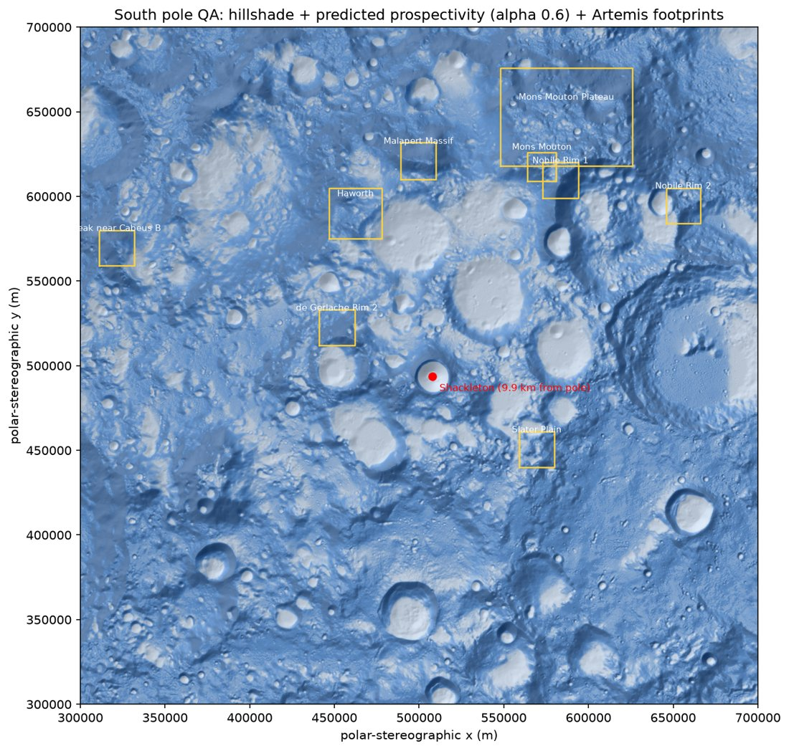

# Task 8 explained: one command that builds every file the website needs

## The one-sentence version

We wrote a single command, `python -m atlas.build all`, that takes all the raw science data on your laptop and turns it into the **27 small, web-ready files** the 3D Moon website will load: the whole-Moon globe, both polar caps with their ice layers, and the nine Artemis landing regions with their statistics.

---

## Why this step is needed

Tasks 2–7 built the individual pieces (map projections, stitching patches together, elevation, colours, landing regions), but each piece only ran on its own. Nothing yet wrote **the actual files a browser downloads**.

A website can't open an 8 GB GeoTIFF or run PyTorch. It needs:

- **small files** (the whole site should stay under ~40 MB),
- in **formats browsers understand** (JPEG, WebP, raw binary numbers, JSON),
- with a **"menu" file** (`meta.json`) that says what each file is, how big it is, and where it sits on the Moon.

Task 8 is the step that produces those files, repeatably, with one command.

---

## Background you need

| Term | Plain meaning |
|---|---|
| **Build step / orchestration** | A script that calls all the earlier, tested functions in the right order and saves their results. It adds no new science; it just connects the pieces. |
| **CLI** | *Command-line interface*: something you run by typing a command, like `python -m atlas.build south`. |
| **Globe vs polar caps** | The website draws the Moon in two parts: a **globe** covering everything up to ±80° latitude, and two detailed **polar caps** (north and south) where the ice data lives. |
| **`height.i16.bin`** | Elevation stored as plain 16-bit whole numbers (metres). It's tiny and loads instantly in JavaScript, with no decoding library needed. |
| **`meta.json`** | A small description file: "the heights are 1440 × 720, in metres; the colour image is `color_4k.jpg`". The website reads this first. |
| **Polar-stereographic (PS)** | The flat map projection used for the poles (from Task 2). On it, a straight line is really straight on the ground near the pole. |

---

## What Task 8 did, step by step

1. **Globe assets (`pipeline/atlas/globe_assets.py`)**, written test-first.
   - NASA's whole-Moon elevation map (`ldem_4.tif`, 1440 × 720) stores heights in **kilometres as decimals**. `km_to_i16_m` converts them to **whole metres** in 16-bit numbers: −9.1234 km becomes −9123 m. The Moon's range (−8.9 km to +10.5 km) fits easily.
   - NASA's LROC colour image (a 59 MB, 16-bit TIFF) becomes two JPEGs: a **4k** version (1.4 MB) for close-up and a **2k** version (0.37 MB) that loads first.
   - It writes `globe/meta.json` describing both.

2. **The build command (`pipeline/atlas/build.py`).** It has five modes:

   | Command | What it produces |
   |---|---|
   | `python -m atlas.build globe` | `web/public/data/globe/` (4 files) |
   | `python -m atlas.build north` | `web/public/data/north/` (11 files: terrain, hillshade, 5 ice layers, 3 hover-value grids, meta) |
   | `python -m atlas.build south` | `web/public/data/south/` (same 11) |
   | `python -m atlas.build regions` | `web/public/data/regions.json` (9 landing regions + statistics) |
   | `python -m atlas.build all` | all of the above, in about 2 minutes |

   For each pole it stitches the 81 patches together (Task 4), puts the LOLA elevation on the same grid (Task 5), applies the validated colours and saves the web files (Task 6). For the regions it computes the Task 7 statistics and adds the source, DOI and download date so the website can credit USGS.

3. **Found and fixed a hidden `.gitignore` problem.** The rule `data/` meant to ignore the big raw-data folder, but it *also* matched `web/public/data/`, so the website's files could never have been committed. It's now `/data/`, which only ignores the top-level folder.

4. **Found and fixed two map-accuracy bugs in the region outlines.** This is the most interesting part of Task 8.

   Each landing region is a square on the polar map. Task 7 stored each square as just its **4 corners in longitude/latitude**. That sounds harmless, but near the pole, "draw a straight line between two lon/lat points" is **not** a straight line on the ground. Lines of longitude all converge on the pole, so a lon/lat-straight edge bends.

   I measured how much the website would get wrong if it joined the corners:

   | Problem | Worst case | Region |
   |---|---|---|
   | Outline edges bow away from the real edge | **6 km** | Mons Mouton Plateau |
   | Region centre ("centroid") in the wrong spot | **1.4 km** | Mons Mouton Plateau |

   6 km is about 25 pixels on the polar map, which is clearly visible. The fixes:
   - **Outlines:** add a point every 1 km along each edge *on the flat polar map*, then convert to lon/lat. Now any straight segment the website draws is at most 1 km long, so the error is tiny. A new test checks this.
   - **Centres:** a new function, `region_centroid`, finds the centre on the flat polar map and converts only that one point to lon/lat. A test checks it lands on the true centre to within 1 m.

   This also corrects the centroids listed in the Task 7 table in `docs/benchmarks.md` (a corrected table was added).

5. **Visual check (`notebooks/qa_plot.py`).** It draws the south pole's terrain, the predicted-ice layer, all nine region outlines and a red dot on **Shackleton crater**, then saves `notebooks/qa_south.png`.

---

## What it accomplished

### Every website file exists, and the total fits the budget

| Folder | Size | What the website uses it for |
|---|---|---|
| `globe/` | 3.8 MB | The whole Moon: shape (heights) and colour |
| `north/` | 16 MB | North-pole cap: 3D terrain, shading, ice layers, hover values |
| `south/` | 15 MB | South-pole cap: same |
| `regions.json` | 84 KB | The 9 Artemis regions: outlines, centres, statistics |
| **Total** | **36.7 MB** | Right at the plan's 36 MB data line, leaving about 3 MB of the 40 MB site budget for the website code |

### The map lines up with real lunar geography



How to read it:

- **The red dot is inside Shackleton crater**, the small, deep, round crater near the centre, exactly where it should be. It sits 9.95 km from the grid centre, which is correct because Shackleton is at 89.67°S, not exactly on the pole.
- **The yellow footprints sit on ridges and plateaus** between the big craters, not on crater floors. That matches NASA's choice of high, sunlit ground.
- The layout matches NASA's official region map: Mons Mouton Plateau at the top, Peak near Cabeus B on the far left, Slater Plain below the pole.
- **Paler blue = higher predicted ice prospectivity** (same colour ramp as the website).

### Tests

| Test | What it proves |
|---|---|
| `test_km_to_i16_m_rounds_and_keeps_sign` | Kilometres become correctly rounded whole metres, negatives included. |
| `test_export_globe_writes_height_bin_jpegs_and_meta` | The globe export writes the heights, both JPEGs and a matching `meta.json`. |
| `test_load_regions_outline_is_dense_enough_to_draw_in_lonlat` | Region outlines have a point at least every 1 km, so they draw accurately. |
| `test_region_centroid_is_the_projected_centre_not_the_lonlat_mean` | Region centres are the true centre on the ground (within 1 m). |

All **56** pipeline tests pass (including the ones that check your real downloaded data), and ruff and mypy report no issues.

---

## What it did *not* do (yet)

- **No website yet.** These files just sit in `web/public/data/`. Task 9 creates the website project, and Tasks 10–12 load these files and draw the 3D Moon.
- **The globe's position on the sphere isn't tested yet.** NASA's `ldem_4.tif` has no built-in location info. By NASA's convention it runs from 180°W on the left to 180°E on the right, with the north pole at the top. Task 11 must use that convention, and it's noted in `docs/benchmarks.md`.
- **The "regions" build recomputes the south-pole layers** rather than reusing the ones from `south`. That's a little slower but simpler, and the whole build still takes about 2 minutes.

---

## How to re-run it

```bash
conda activate ni-lfm
python -m atlas.build all          # ~2 min → web/public/data/
python notebooks/qa_plot.py        # → notebooks/qa_south.png
pytest -q                          # 56 tests
```

The task's checklist is in [`plan.md`](../plan.md), Task 8.
